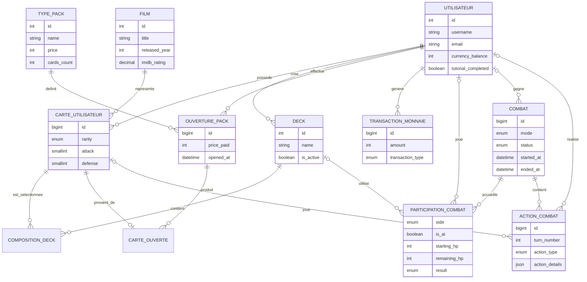
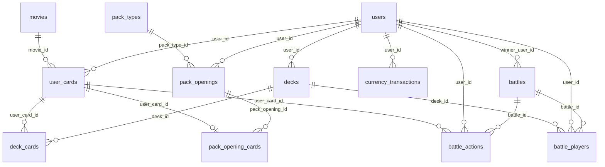

# MCD et MLD - Absolute Cinema

Ce document est derive du schema local `bdd_abs_cin.sql`. Le fichier SQL et ses donnees restent locaux et ne sont pas necessaires pour lire ces modeles.

## MCD

Le modele conceptuel represente les objets metier et leurs associations principales.

### Regles metier principales

- Un utilisateur peut posseder plusieurs exemplaires d'un meme film.
- Un deck appartient a un seul utilisateur et reference des exemplaires precis de cartes.
- Une carte ouverte provient d'au plus une ouverture de pack.
- Un combat peut opposer un utilisateur a un autre joueur ou a l'IA.
- Un combat possede deux participants identifies par `player1` et `player2`.
- Une transaction de monnaie appartient toujours a un utilisateur.

## MLD

Le modele logique relationnel reprend les tables, les cles et les cardinalites implementees en MySQL.

### Tables

| Table | Cle primaire | Cles et contraintes principales |
| --- | --- | --- |
| `movies` | `id` | Index sur titre, annee et note IMDb |
| `users` | `id` | `username` et `email` uniques |
| `user_cards` | `id` | FK vers `users` et `movies`; doublons de cartes autorises |
| `decks` | `id` | FK vers `users` |
| `deck_cards` | `deck_id`, `user_card_id` | FK vers `decks` et `user_cards`; position unique dans un deck |
| `pack_types` | `id` | `name` unique |
| `pack_openings` | `id` | FK vers `users` et `pack_types` |
| `pack_opening_cards` | `pack_opening_id`, `user_card_id` | Une carte ne peut provenir que d'une ouverture |
| `currency_transactions` | `id` | FK vers `users`; montant signe pour gains et depenses |
| `battles` | `id` | FK optionnelle vers le gagnant `users.id` |
| `battle_players` | `battle_id`, `side` | FK vers `battles`, `users` et `decks`; deux camps par combat |
| `battle_actions` | `id` | FK vers `battles`, `users` et `user_cards` |

## Correspondance des cardinalites

- `users 1,n user_cards`, `movies 1,n user_cards`
- `users 1,n decks`, `decks n,n user_cards` via `deck_cards`
- `users 1,n pack_openings`, `pack_types 1,n pack_openings`
- `pack_openings n,n user_cards` via `pack_opening_cards`, avec une carte liee a une seule ouverture au maximum
- `users 1,n currency_transactions`
- `battles 1,n battle_players` et `battles 1,n battle_actions`